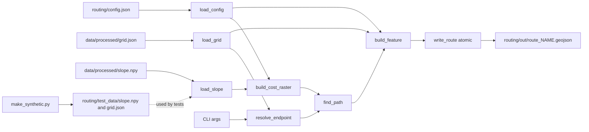

# Design Document

## Overview

This design covers the least-cost path tool owned by role B under `routing/`. The tool reads `data/processed/slope.npy` and `data/processed/grid.json`, builds a cost raster from parameters in `routing/config.json`, finds the cheapest path between two endpoints with `skimage.graph.route_through_array`, and writes one GeoJSON route file, `routing/out/route_<name>.geojson`. A second script generates a synthetic slope map and grid under `routing/test_data/` so the router and its tests run before real data exists.

Scope limits taken from the requirements and steering:

- Role B writes only under `routing/` and `validation/`. This feature writes only under `routing/out/` (router) and `routing/test_data/` (generator). Nothing under `validation/` is touched.
- Python 3.12 or newer, numpy, scikit-image. Every script is a command-line program that prints one line per file written (path and size in bytes) and opens no window.
- All cost parameters live only in `routing/config.json`. Each parameter is stored as `{value, basis}`. The cost values are a relative cost ranking, not a validated human EVA model.
- No validation numbers are computed or written. Comparison routes (`route_<name>_no_<layer>.geojson`) and validation against the Perseverance traverse are out of scope.
- Formats follow `docs/INTERFACES.md`. Cost and route rules follow `docs/research/nico-routing-spec.md`.
- Tests use only synthetic data from `routing/test_data/` or arrays defined in the test code.

### Research findings that shape the design

- `skimage.graph.route_through_array(array, start, end, fully_connected=True, geometric=True)` returns `(path, cost)`. With `geometric=True` the cost of a step is the mean of the two cell costs multiplied by the step length (1 for orthogonal, sqrt(2) for diagonal moves). This makes path cost symmetric when start and end are swapped, which is what Property 7 relies on. Source: [scikit-image graph API](https://scikit-image.org/docs/stable/api/skimage.graph.html).
- Cells with `np.inf` cost are never entered. When no finite path exists, the function can either raise or return an infinite cost. The router treats both outcomes as Unreachable. This must be confirmed by a test against the pinned scikit-image version (see Error Handling).
- Per Nico's spec, the cost formula is `1 + (slope / limit)^2`, slopes above 20 degrees and NaN cells are blocked, and the 20 degree limit is a team choice referenced to a rover limit, not a human limit. Basis text is stored in the config (Requirements 1.3, 1.4).
- Hypothesis is the standard property-based testing library for Python. It is not yet in `routing/requirements.txt` and must be added there (see Testing Strategy).

## Architecture

The router is split into pure functions (testable by property) and a thin I/O shell. The CLI parses arguments, loads and validates inputs, calls the pure core, and writes the output atomically.



Design decisions:

| Decision | Rationale |
|---|---|
| Pure core, I/O shell | Properties 2 to 10 run on in-memory arrays with no file I/O, which keeps 100+ iterations cheap. |
| One module `route.py` for the router, no package | The feature is small. A single file is easy to review and to run as `python routing/route.py`. |
| Custom exception `RoutingError(message, exit_code)` | Every error path carries a message and a distinct exit code. `main()` is the only place that prints and exits. |
| Output path is a module constant `OUT_DIR` | Requirement 9.3 forbids a user-selectable output directory. Tests monkeypatch the constant to a temporary directory. |
| Atomic write (temp file in the same directory, then `os.replace`) | Requirement 6.17 forbids partial files. The size check happens before the replace (Requirement 9.4). |
| Connectivity is a config value in `{4, 8}`; `geometric=True` is fixed in code | Requirement 1.1 puts connectivity in the config. Geometric weighting is mandated by Requirement 5.1 and Nico's spec. It is named in the `cost_function` string. |
| Cost form `base + coefficient * (slope/limit)^exponent` | Requirement 1.8 forbids cost constants outside the config. The shipped values (1, 1, 2) give exactly `1 + (slope/limit)^2`. |

Exit codes: `0` success, `1` Unreachable, `2` invalid arguments or invalid input files or config. Any non-zero value satisfies the requirements; the distinction helps scripts.

## Components and Interfaces

### File layout (role B, `routing/`)

```
routing/
  config.json              # all parameters, each as {value, basis}
  requirements.txt         # pinned dependencies (add hypothesis and pytest)
  route.py                 # router: pure core + CLI
  out/                     # route_<name>.geojson written here (created on demand)
  test_data/
    make_synthetic.py      # test data generator CLI
    slope.npy              # generated, synthetic, under 50 MB
    grid.json              # generated, synthetic
  tests/
    conftest.py            # adds routing/ to sys.path, shared fixtures and strategies
    test_config.py
    test_inputs.py
    test_cost.py
    test_endpoints.py
    test_path.py           # validity, optimality, symmetry
    test_output.py         # GeoJSON properties, round trip, name rules
    test_scenarios.py      # Requirement 8 example scenarios
    test_generator.py
    test_cli.py
```

`routing/test_data/slope.npy` and `grid.json` may be committed (small) or regenerated by the generator. Tests do not depend on committed copies: fixtures call the generator functions into `tmp_path`.

### route.py: public functions

```python
class RoutingError(Exception):
    message: str
    exit_code: int            # 1 unreachable, 2 invalid input

@dataclass(frozen=True)
class CostParams:
    slope_limit_deg: float
    cost_base: float
    cost_coefficient: float
    cost_exponent: float
    connectivity: int          # 4 or 8

@dataclass(frozen=True)
class Grid:
    pixel_size_m: float
    width: int
    height: int
    easting_m: float           # top_left.easting_m
    northing_m: float          # top_left.northing_m
    crs: str

def load_config(path: Path) -> tuple[CostParams, dict]:
    """Return validated parameters and the raw config (for generated_from).
    Raises RoutingError(exit 2) naming the missing file or item (Req 1.6, 1.7)."""

def load_grid(path: Path) -> Grid:                       # Req 2.3, 2.6, 2.7, 2.8
def load_slope(path: Path, grid: Grid) -> np.ndarray:    # Req 2.3, 2.4, 2.5, 2.7

def build_cost_raster(slope: np.ndarray, p: CostParams) -> np.ndarray:
    """Pure. float64 array, same shape. Blocked cells are np.inf."""   # Req 3

def coord_to_pixel(easting_m: float, northing_m: float, g: Grid) -> tuple[int, int]:  # Req 4.2
def pixel_to_coord(row: int, col: int, g: Grid) -> tuple[float, float]:               # Req 6.3 (pixel centre)

def resolve_endpoint(label: str, spec: EndpointSpec, g: Grid) -> tuple[int, int]:
    """Validate form, finiteness, and grid bounds. Raises RoutingError."""  # Req 4.5 to 4.7

def find_path(cost: np.ndarray, start: tuple[int, int], end: tuple[int, int],
              connectivity: int) -> tuple[list[tuple[int, int]], float]:
    """Raises RoutingError(exit 1) if an endpoint is blocked or no path exists."""  # Req 5

def path_cost(cost: np.ndarray, path: list[tuple[int, int]]) -> float:
    """Sum of 0.5*(c_i + c_j) * step_length. Used by tests and Property 7."""

def build_feature(name, path, slope, g, p, raw_config, start_poi, end_poi, commit) -> dict:  # Req 6.3 to 6.12
def get_commit_hash() -> str:     # `git rev-parse HEAD`, returns "unknown" on any failure (Req 6.16)
def write_route(feature: dict, name: str) -> Path:   # atomic, creates OUT_DIR, size limit (Req 6.13, 6.17, 9.4)
def validate_name(name: str) -> None:                # regex ^[A-Za-z0-9_-]{1,64}$ (Req 6.1, 6.2)
def main(argv: list[str] | None = None) -> int
```

`find_path` calls `route_through_array(cost, start, end, fully_connected=(connectivity == 8), geometric=True)`. It checks blocked endpoints first so the error names which endpoint is blocked (Req 5.3). A `ValueError` from the library or a non-finite returned cost becomes "no path exists" (Req 5.4).

### Router CLI

```
python routing/route.py --name NAME
    (--start-rc ROW COL | --start-en EASTING NORTHING)
    (--end-rc ROW COL   | --end-en EASTING NORTHING)
    [--start-poi ID] [--end-poi ID]
    [--slope PATH]   default data/processed/slope.npy
    [--grid PATH]    default data/processed/grid.json
    [--config PATH]  default routing/config.json
```

- Default paths are resolved against the repository root (parent of `routing/`), so the command works from any working directory.
- Each endpoint takes exactly one form. argparse mutually exclusive groups with `required=True` enforce this (Req 4.6). Non-numeric values are rejected by argparse (`type=float`); NaN and infinity are rejected by `resolve_endpoint` (Req 4.7). Row and column given with `--start-rc` must be integers (`type=int`).
- On success the router prints exactly one line to stdout: `routing/out/route_<name>.geojson <size_bytes>` (Req 6.14). Errors go to stderr.
- Invalid or incomplete arguments print a usage message to stderr, exit non-zero, and write nothing (Req 9.5). argparse exits with code 2, which matches the exit code scheme.
- The router never prompts and never opens a window (Req 9.2).
- No validation metrics and no comparison routes are produced (Req 9.7).

### Test data generator CLI

```
python routing/test_data/make_synthetic.py --seed INT
    [--width N] [--height N] [--pixel-size M] [--config PATH]
```

Defaults: 64 by 64 cells, pixel size 1.0 m. Output goes only to `routing/test_data/` (Req 9.3). Behaviour:

1. Validate the seed (integer) and the size (1 to 1024 per side; also reject sizes whose `slope.npy` would reach 50 MB, 52,428,800 bytes. A 1024 by 1024 float32 array is 4 MiB, so the 50 MB limit is never reached within the size range; see Error Handling) (Req 7.2, 7.7).
2. Create the field with `numpy.random.default_rng(seed)`: smooth random terrain from a Gaussian-filtered noise field (`skimage.filters.gaussian`), scaled into 2 to 15 degrees so background cells stay below the slope limit.
3. Plant required features: a flat block (at least 10 cells, values at or below 1.0), a steep block (at least 10 cells, value `slope_limit + 10` degrees, capped at 90, with the limit read from `routing/config.json` so it stays above the real limit), and at least one NaN cell (Req 7.3).
4. Clip finite values to 0.0 to 90.0 and cast to float32 (Req 7.1).
5. Write `grid.json` with `crs` set to a string containing `SYNTHETIC`, `synthetic: true`, and `nodata_value: null` (Req 7.5). Write with sorted keys and 2-space indent so output is deterministic.
6. Write both files to temporary names in `routing/test_data/`, then `os.replace` both, so existing files stay unchanged if anything fails (Req 7.8). Print one line per file: path and size (Req 7.6).

The generator is imported by tests as a function `generate(seed, width, height, pixel_size_m, steep_deg) -> (slope, grid_dict)` so tests can build arrays in memory without disk I/O. The CLI wraps this function.

### config.json schema

Every parameter is an object with a `value` and a `basis`. The basis is a non-empty string that states the source, the version, and the date in `YYYY-MM-DD` format (Req 1.2). `load_config` checks the date with the regex `\d{4}-\d{2}-\d{2}` and `datetime.date.fromisoformat`.

| Key | `value` type | Constraint | Shipped value |
|---|---|---|---|
| `cost_function` | string | must equal `"quadratic_slope"` (the only supported form) | `"quadratic_slope"` |
| `slope_limit_deg` | number | finite, greater than 0 | `20` |
| `cost_base` | number | finite, greater than 0 | `1.0` |
| `cost_coefficient` | number | finite, greater than 0 | `1.0` |
| `cost_exponent` | number | finite, greater than 0 | `2.0` |
| `connectivity` | integer | `4` or `8` | `8` |

Shipped file:

```json
{
  "cost_function": {
    "value": "quadratic_slope",
    "basis": "Team choice, docs/research/nico-routing-spec.md, 2026-11-14. Cost = cost_base + cost_coefficient * (slope / slope_limit_deg) ^ cost_exponent. Transparent heuristic, not fitted to data. Qualitatively consistent with Minetti et al. 2002 (https://iris.unibs.it/handle/11379/540545), measured under Earth gravity. Results are a relative cost ranking only, not a prediction of real energy use."
  },
  "slope_limit_deg": {
    "value": 20,
    "basis": "Team choice, docs/research/nico-routing-spec.md, 2026-11-14. Referenced to a rover limit: Perseverance autonomous navigation on slopes above 20 degrees (JPL, https://robotics.jpl.nasa.gov/media/documents/2026_RO_AAS_final.pdf). This is not a human or spacesuit limit."
  },
  "cost_base":        { "value": 1.0, "basis": "Team choice, nico-routing-spec.md, 2026-11-14. A flat cell costs 1." },
  "cost_coefficient": { "value": 1.0, "basis": "Team choice, nico-routing-spec.md, 2026-11-14. A cell at the limit costs 2." },
  "cost_exponent":    { "value": 2.0, "basis": "Team choice, nico-routing-spec.md, 2026-11-14. Quadratic growth with slope." },
  "connectivity":     { "value": 8,   "basis": "Team choice, nico-routing-spec.md, 2026-11-14. 8-neighbour (skimage fully_connected=True)." }
}
```

Parameters are written and committed before any run and are not changed after seeing results (tech steering). The router contains no default for any of these values: a missing key is an error (Req 1.6, 1.8).

## Data Models

Inputs (formats from `docs/INTERFACES.md`):

- `slope.npy`: 2D float32 array `(height, width)`, degrees, NaN for missing cells.
- `grid.json`: fields used by the router are `pixel_size_m`, `width`, `height`, `top_left.{easting_m, northing_m}`, `crs`. Other fields are ignored. The generator additionally writes `nodata_value` and `synthetic`.

Cost raster: float64 array, same shape as the slope raster. Cell value is `base + coefficient * (|slope| / limit) ** exponent` when `|slope|` is finite and at most the limit, otherwise `np.inf`. The comparison is `abs_slope <= limit`, so a cell exactly at the limit is traversable (Req 3.2, 8.5). Boundary note: float32 slope values are promoted to float64 before comparison with the limit.

Pixel and coordinate mapping (Req 4.2, 6.3):

```
col = floor((easting_m  - top_left.easting_m)  / pixel_size_m)
row = floor((top_left.northing_m - northing_m) / pixel_size_m)

centre_easting_m  = top_left.easting_m  + (col + 0.5) * pixel_size_m
centre_northing_m = top_left.northing_m - (row + 0.5) * pixel_size_m
```

Route file (one GeoJSON Feature, 2-space indent, UTF-8):

```json
{
  "type": "Feature",
  "geometry": { "type": "LineString", "coordinates": [[easting_m, northing_m], "..."] },
  "properties": {
    "name": "<name>",
    "start_poi": "<id or null>",
    "end_poi": "<id or null>",
    "length_m": 0.0,
    "max_slope_deg": 0.0,
    "slope_threshold_deg": 20,
    "data_used": ["slope"],
    "cost_function": "quadratic_slope: cost = cost_base + cost_coefficient * (slope / slope_limit_deg) ^ cost_exponent; cost_base=1.0, cost_coefficient=1.0, cost_exponent=2.0, slope_limit_deg=20, connectivity=8, geometric=true",
    "generated_from": "commit=<40-hex or unknown>; config=<config.json content, minified>"
  }
}
```

- `length_m`: sum of Euclidean distances between consecutive coordinates, `round(x, 2)`.
- `max_slope_deg`: maximum raw slope value among path cells, `round(x, 2)`.
- `cost_function` is built from the loaded values, so it changes when the config changes. If the text would exceed 500 characters, the parameter list is shortened to names and values only (no prose); the shipped config stays well below the limit.
- A single-cell route has a LineString with one coordinate and `length_m` of 0 (Req 5.2, 6.3).
- Every key in `properties` is one of the nine above; no validation metric appears (Req 9.7).

## Correctness Properties

_A property is a characteristic or behavior that should hold true across all valid executions of a system, that is, a formal statement about what the system should do. Properties serve as the bridge between human-readable specifications and machine-verifiable correctness guarantees._

Reflection on redundancy: criteria 3.1 to 3.4 and 3.7 are one statement about the cost function and are merged with 1.8 (config drives costs). Criteria 3.5 and 5.6 merge into path validity. Criteria 4.5, 5.3, 5.4 and 5.5 merge into one "unreachable writes nothing" property. Criteria 6.1, 6.4 to 6.8 and 6.10 merge into one property on route properties. Criteria 1.6, 1.7, 3.6 merge into config validation. Criteria 2.4, 2.5, 2.6 and 2.8 are kept as one input validation property because they share one structure (any malformed input is rejected with a message naming the cause). Criteria with fixed expected results (for example 1.3, 1.4, 8.2 to 8.6) are example or smoke tests, listed in the Testing Strategy.

### Property 1: Config validation rejects every invalid config

For any config derived from the valid shipped config by removing a required key, removing or blanking a `value` or `basis` field, using a basis without a `YYYY-MM-DD` date, or setting a numeric value to a non-finite or non-positive number, a non-integer or unsupported connectivity (not 4 or 8), or an unsupported `cost_function` value, `load_config` should raise `RoutingError` with exit code 2 and a message that contains the name of the offending key (and, for invalid values, the rejected value). The shipped config should load without error.

**Validates: Requirements 1.2, 1.6, 1.7, 3.6**

### Property 2: Cost raster follows the configured formula

For any valid parameters (limit, base, coefficient, exponent, all finite and greater than 0) and any 2D slope array that may contain negative values, NaN and values above the limit, the cost raster should have the same shape as the slope array. A cell is `np.inf` exactly when its slope is NaN or `|slope|` is greater than the limit. Every other cell equals `base + coefficient * (|slope| / limit) ** exponent`. With the shipped parameters, every non-blocked cell lies in [1.0, 2.0], a cell at slope 0 costs 1.0, and a cell at slope equal to the limit costs 2.0.

**Validates: Requirements 1.8, 3.1, 3.2, 3.3, 3.4, 3.7**

### Property 3: Malformed inputs are rejected with a message naming the cause

For any slope array whose number of dimensions is not 2, `load_slope` should raise with a message containing the actual number of dimensions. For any 2D slope array whose shape differs from `(height, width)`, the message should contain both shapes. For any `grid.json` missing any non-empty subset of `pixel_size_m`, `width`, `height`, `top_left`, `crs`, the message should name every missing field. For any `pixel_size_m` that is not a number greater than 0, or any `width` or `height` that is not an integer greater than 0, the message should name the field and its value. In all these cases the exit code is 2 and no file is written.

**Validates: Requirements 2.2, 2.4, 2.5, 2.6, 2.8**

### Property 4: Coordinate conversion is consistent with the pixel grid

For any valid grid and any pixel `(row, col)` inside it, `coord_to_pixel(*pixel_to_coord(row, col, grid), grid)` returns `(row, col)`. For any point strictly inside pixel `(row, col)` (offset from the pixel's top-left corner by a fraction in [0, 1) of the pixel size in each axis), `coord_to_pixel` returns `(row, col)`.

**Validates: Requirements 4.2, 6.3**

### Property 5: Returned paths are valid

For any cost raster (with arbitrary blocked cells) and any pair of non-blocked endpoints for which a path is returned, the first cell is the start, the last cell is the end, every cell is non-blocked (finite cost), and every consecutive pair of cells are neighbours under the configured connectivity (8-neighbour: row and column each differ by at most 1 and the cells differ; 4-neighbour: exactly one differs by 1).

**Validates: Requirements 3.5, 5.1, 5.6**

### Property 6: Returned paths are cost-optimal

For any cost raster of at most 8 by 8 cells and any pair of non-blocked endpoints, the existence of a path matches a reference Dijkstra implementation written in the test, and when a path exists the total cost of the returned path (computed with `path_cost`) equals the reference minimum cost within a relative tolerance of 1e-9.

**Validates: Requirements 5.1, 5.4**

### Property 7: Path cost is symmetric

For any cost raster and any pair of non-blocked endpoints for which a path exists, the total cost of the path from start to end and the total cost of the path from end to start differ by no more than 1e-6 relative.

**Validates: Requirements 5.7**

### Property 8: Unreachable runs write nothing

For any grid and endpoints where at least one endpoint is outside the grid, or is a blocked cell (NaN or above the limit), or where no non-blocked path connects the endpoints, running the router returns a non-zero exit status, writes no route file in the output directory, and prints an error that names the offending endpoint (start, end, or both) or states that no path exists. Both endpoints keep their given values; no substitute cell is used.

**Validates: Requirements 4.5, 5.3, 5.4, 5.5**

### Property 9: Route file round trip

For any slope grid, grid description, valid endpoints with a path, any valid name, and any POI identifier text (or none), writing the route and parsing the file back gives a LineString whose coordinates, converted back with `coord_to_pixel`, equal the path cells in the same order with exact row and column. The properties `start_poi` and `end_poi` equal the given identifiers, or null when none was given.

**Validates: Requirements 4.3, 4.4, 6.3, 6.15**

### Property 10: Route properties match the route

For any route written by the router, the feature has exactly one LineString geometry and exactly the nine properties `name`, `start_poi`, `end_poi`, `length_m`, `max_slope_deg`, `slope_threshold_deg`, `data_used`, `cost_function`, `generated_from`. `name` equals the argument. `length_m` equals the sum of Euclidean distances between consecutive coordinates rounded to 0.01. `max_slope_deg` equals the maximum slope among the path cells rounded to 0.01. `slope_threshold_deg` equals the config limit. `data_used` equals `["slope"]`. `cost_function` has 1 to 500 characters and contains the name and value of every parameter read from the config. `generated_from` contains the config content.

**Validates: Requirements 6.1, 6.4, 6.5, 6.6, 6.7, 6.8, 6.9, 6.10, 6.11, 9.7**

### Property 11: Route name validation

For any string, the router accepts it as `<name>` if and only if it matches `^[A-Za-z0-9_-]{1,64}$`. For any rejected string, no route file is written and the exit status is non-zero.

**Validates: Requirements 6.1, 6.2**

### Property 12: Generated test data is valid and contains the required features

For any integer seed and any valid size, the generator output slope array is 2D float32 with shape `(height, width)`, all finite values in [0.0, 90.0], at least one NaN, a contiguous region of at least 10 cells with all values at or below 1.0, and a contiguous region of at least 10 cells with all values above the slope limit. The grid description has `pixel_size_m` greater than 0, integer `width` and `height` from 1 to 1024, `top_left` with `easting_m` and `northing_m`, a `crs` containing `SYNTHETIC`, `synthetic` equal to `true`, and `nodata_value` as a number or null.

**Validates: Requirements 7.1, 7.2, 7.3, 7.5**

### Property 13: Generator is deterministic

For any integer seed and valid size, running the generator twice with identical arguments produces `slope.npy` and `grid.json` files that are byte-for-byte identical between the two runs.

**Validates: Requirements 7.4**

## Error Handling

All errors raise `RoutingError(message, exit_code)` inside the core. `main()` catches it, prints `error: <message>` to stderr, and returns the exit code. No output file is created before all inputs are validated and the path is found. Order of checks: arguments (argparse), name, config, grid, slope, endpoints, cost raster, path, then write.

| Situation | Requirement | Exit | Message names |
|---|---|---|---|
| Invalid or incomplete arguments, both endpoint forms given | 4.6, 9.5 | 2 | usage text (argparse) |
| Invalid `<name>` | 6.2 | 2 | the name rule |
| Config, grid, or slope file missing or unreadable | 1.6, 2.3 | 2 | the file path |
| Config or grid is invalid JSON; slope file is not a valid array | 1.6, 2.7 | 2 | the file path and "malformed" |
| Config key, value, basis, or value range invalid | 1.6, 1.7, 3.6 | 2 | the key and rejected value |
| Slope not 2D, shape mismatch, grid field missing or invalid | 2.4 to 2.8 | 2 | ndim, both shapes, or field names |
| Endpoint NaN, infinity, or non-numeric | 4.7 | 2 | which endpoint and value |
| Endpoint outside grid | 4.5 | 1 | which endpoint (start or end) |
| Endpoint on blocked cell | 5.3 | 1 | start, end, or both |
| No path | 5.4 | 1 | "no path exists" |
| Git commit unavailable | 6.16 | continues | `generated_from` uses `unknown` |
| Write failure or full disk | 6.17 | 2 | the file path; temp file removed |
| Route file size at or above 52,428,800 bytes | 9.4 | 2 | file path and the size limit; temp file removed |

Implementation notes:

- Config values are validated with `math.isfinite`. Booleans are rejected for numeric parameters (`isinstance(v, bool)` check) because `True` is an `int` in Python.
- A `NaN` in the config cannot occur in strict JSON, but Python's `json` module accepts `NaN`; `isfinite` catches it.
- Unreachable detection has two paths: pre-check blocked endpoints, then treat a `ValueError` from `route_through_array` or an infinite returned cost as "no path exists". A test pins this behavior on the installed scikit-image version.
- The Generator rejects sizes where `height * width * 4 + header` is at least 52,428,800 bytes. This is a safeguard only: the size range is up to 1024 per side (4 MiB at most), so it is not reachable through valid sizes. Larger arrays would fail with a message naming the size limit (Req 7.7) and leave existing files unchanged.
- Writes use `tempfile.NamedTemporaryFile(dir=OUT_DIR, delete=False)` followed by `os.replace`. On any `OSError`, the temp file is deleted in a `finally` block.
- Floating point: `length_m` and `max_slope_deg` use Python `round(x, 2)`. Coordinates are written as full-precision floats so the round trip is exact.

## Testing Strategy

Property-based testing applies: the core is made of pure functions over arrays (cost raster, coordinate conversion, path search, GeoJSON construction), with a large input space and clear universal properties. The I/O shell is covered by example tests.

### Tools and dependencies

- Test runner: `pytest`. Property-based testing library: `hypothesis`. Neither is in `routing/requirements.txt` yet. When implementing, install them in `.venv`, then add both with pinned versions (the file pins every dependency, for example `numpy==2.5.4`) to `routing/requirements.txt`. This is the only change to that file.
- Property-based tests are not implemented from scratch.
- Run command: `python -m pytest routing/tests -q` (single run, no watch mode).

### Property tests

- Each correctness property above is implemented by exactly one hypothesis test.
- Each test runs at least 100 examples: `@settings(max_examples=100, deadline=None)` (use a higher number for fast pure functions).
- Each test carries a comment with the tag format `Feature: b-routing, Property <n>: <property text>`.
- Shared strategies in `conftest.py`:
  - `slope_grids`: 2D float arrays, 2 to 20 rows and columns, values from a mix of sampled floats in [0, 90], values exactly at the limit, values just above it (`np.nextafter`), and NaN.
  - `grids`: valid `Grid` objects (positive `pixel_size_m`, finite top-left coordinates, matching width and height).
  - `endpoints`: pairs of pixels inside the grid, including equal pairs (single-cell route, Req 5.2).
  - `bad_configs`: mutations of the shipped config (Property 1).
- Properties 8 to 11 call `main()` with `OUT_DIR` monkeypatched to a `tmp_path` and with temporary slope, grid, and config files. Use `hypothesis`-compatible fixtures (`tmp_path_factory` or a function that creates a fresh temporary directory per example), because function-scoped fixtures are shared across examples.
- Property 6 uses a reference Dijkstra in the test file (heapq, 8 or 4 neighbours, same step-cost rule), grids at most 8 by 8.
- Edge cases handled by generators: endpoints equal, NaN cells, values at the limit, float32 rounding, 1 by 1 grids, names of length 64 and 65, non-ASCII names.

### Example and smoke tests (Requirement 8)

All use arrays defined inside the test code of at most 100 by 100 cells, or generator output written into `tmp_path`. No test reads from `data/processed/`.

| Test | Requirement |
|---|---|
| Ridge row with one gap cell: success, path contains the gap cell, no cell above the limit | 8.2 |
| Full-width ridge: Unreachable, no route file | 8.3 |
| NaN on the start cell, and NaN on the end cell (two tests): Unreachable, no route file | 8.4 |
| Slope exactly at the limit is traversable, slope one step above is blocked, on the same grid | 8.5 |
| 5 by 5 hand-computed route: exact coordinates (tolerance 1e-9 m for floats), all properties as literals, `start_poi` and `end_poi` null and set variants, `data_used`, one stdout line with path and size | 8.6, 4.1, 4.4, 6.9, 6.14 |
| Two temporary configs that differ only in `slope_limit_deg`: the lower limit gives a longer route or Unreachable, never a shorter one; default config file not modified | 8.7 |
| Lint-style test: test sources contain no reference to `data/processed` and no validation reference values | 8.1, 8.8 |
| Shipped `config.json`: values equal the shipped table, bases contain the JPL URL, the words "team choice" and "not a human or spacesuit limit"; cost basis contains the Minetti URL, "Earth gravity", "relative cost ranking" | 1.3, 1.4, 1.5 |
| Missing, unreadable, and malformed files for slope, grid, config | 2.3, 2.7 |
| Argument defaults, both endpoint forms given, missing endpoint, NaN endpoint, no output on usage error | 2.1, 4.6, 4.7, 9.5 |
| Output directory created when absent | 6.13 |
| Git failure gives `unknown` (monkeypatch `subprocess.run`) | 6.16 |
| Write failure leaves no partial file (monkeypatch `os.replace`) | 6.17 |
| Size limit: monkeypatch `MAX_BYTES` to a small value, expect non-zero exit and no file | 9.4 |
| Generator: one line per file, bad seed, unwritable directory leaves earlier files unchanged, size above 50 MB rejected | 7.6, 7.7, 7.8 |
| Subprocess run with closed stdin exits 0 and opens no window | 9.2, 9.6 |
| Python version is 3.12 or newer (sys.version_info >= (3, 12)) | 9.1 |

### Traceability to non-testable items

No requirement is left untested. Criteria that only describe shipped file content (1.3, 1.4, 1.5) are smoke tests. No test asserts a validation reference value (Req 8.8), and no test or script writes under `validation/`.
